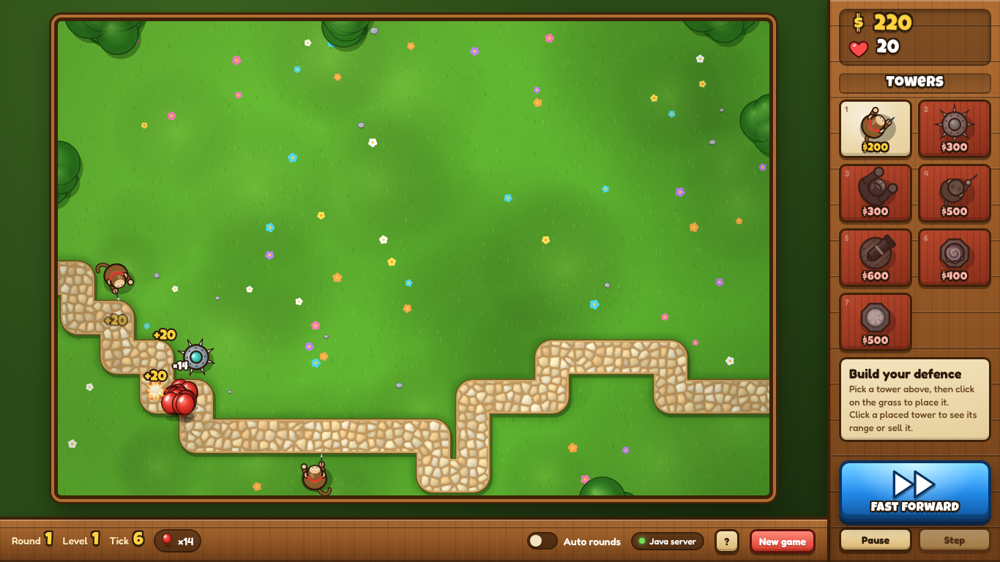

# l2s4-projet-2026

# Equipe

- BORIS MUTAGOMA
- SERIGNE CISSE 
- Mehdi Bellache 
- Hélio DEQUEKER

# Sujet

[Le sujet 2026](https://www.fil.univ-lille.fr/~varre/portail/l2s4-projet/sujet2026.pdf)

# 🎮 Jouer en ligne

👉 **[Lancer le jeu dans le navigateur](https://borismutagoma.github.io/Tower-Defense-Game-Group-Project/web/)**

Code source : [github.com/borismutagoma/Tower-Defense-Game-Group-Project](https://github.com/borismutagoma/Tower-Defense-Game-Group-Project)



> **À savoir :** GitHub Pages n'héberge que des fichiers statiques (HTML, CSS, JavaScript) et ne peut donc pas exécuter notre serveur Java.
> Sur la version en ligne, la page le détecte et lance une **démo hors-ligne** (`web/sim.js`) qui reproduit les règles du jeu en JavaScript (badge *« Offline demo »* en bas de l'écran).
> Pour jouer avec le **vrai moteur Java**, lancez le serveur en local (voir ci-dessous) : le badge affiche alors *« Java server »*.

### Lancer la version web avec le moteur Java (en local)

Depuis la racine du projet :

```bash
make classes                                        # compile les sources dans classes/
java -cp classes towerdefense.web.WebGameServer     # démarre le serveur sur le port 8080
```

Puis ouvrir **http://localhost:8080** dans un navigateur. (Un autre port peut être passé en argument : `java -cp classes towerdefense.web.WebGameServer 9000`.)

> Le serveur doit être lancé depuis la racine du projet, car il sert les fichiers du dossier `web/`.

### Commandes en jeu

| Action | Souris / bouton | Clavier |
|---|---|---|
| Choisir une tour | Cliquer sur une tuile de la boutique | `1` à `7` |
| Poser la tour | Cliquer sur l'herbe (Maj + clic pour en poser plusieurs) | — |
| Voir la portée / vendre une tour | Cliquer sur une tour posée, puis *« Sell »* | `Suppr` |
| Lancer une manche / accélérer | Gros bouton bleu | `R` / `F` |
| Pause / reprise | *Pause* | `P` |
| Avancer d'un seul tick | *Step* | `Espace` |
| Enchaîner les manches automatiquement | Interrupteur *Auto rounds* | `A` |
| Annuler | Clic droit | `Échap` |

---

# 🧩 Conception du jeu

Le projet a été conçu en deux couches bien séparées :

1. **Le moteur de jeu en Java** (`src/towerdefense/`), construit livrable après livrable, qui contient **toutes les règles** ;
2. **L'interface web** (`web/` + `src/towerdefense/web/WebGameServer.java`), ajoutée à la fin, qui ne fait qu'**afficher** l'état du moteur et lui transmettre les actions du joueur.

Cette séparation permet de modifier l'apparence du jeu sans jamais toucher à la logique, et inversement.

## 1. Le moteur Java

### Le plateau et le chemin

- Le plateau (`Board`, classe abstraite) est une **grille à deux dimensions** de `Cell` (`Cell[][]`). Chaque cellule connaît sa `Position` et sait si elle fait partie du chemin.
- Les sous-classes de `Board` correspondent aux modes de jeu : `ClassicalBoard` (un seul chemin), `RandomBoard` (plusieurs chemins) et `DebugBoard` (chemin fixe pour les tests).
- La génération du chemin a été sortie des plateaux et placée dans le paquetage `path.generators` (`GeneratePath`, `GenerateOnePath`, `GenerateMultiplePath`…). Le chemin part de la colonne de gauche et avance vers la droite, en favorisant les déplacements vers la droite (la cellule de droite est ajoutée deux fois dans le tirage) et sans jamais repasser sur une cellule déjà utilisée. Si la génération échoue ou si le chemin est trop court, on recommence (jusqu'à 1000 tentatives).

### Les ballons

- `Balloon` est une **classe abstraite** : chaque sous-classe définit seulement sa vie et sa vitesse par défaut. Les noms évoquent le ciel et les nuages :

| Ballon | Vie | Vitesse | Particularité |
|---|---|---|---|
| `CumulusBalloon` | 1.0 | 1.0 | ballon de base |
| `ZephyrBalloon` | 0.8 | 1.5 | rapide mais fragile |
| `StratusBalloon` | 2.0 | 0.5 | lent mais résistant |

- Un ballon suit son `Path` cellule par cellule : à chaque tick, il accumule sa vitesse et avance d'une cellule chaque fois que le cumul dépasse 1. Sa **position exacte** est interpolée entre deux cellules, ce qui permet un calcul de portée précis (et une animation fluide côté web).
- Les **effets** (`Effect.SLOWED` : vitesse × 0,5 pendant 10 ticks, `Effect.FREEZE` : immobilisé pendant 10 ticks) modifient la vitesse renvoyée par `getSpeed()`.
- La génération des vagues est confiée aux générateurs (`BalloonGenerator`, `EvolvingBalloonGenerator`…). L'`EvolvingBalloonGenerator` débloque de nouveaux types de ballons au fil des niveaux et retire les plus faibles tous les 3 niveaux.

### Les tours : trois piliers indépendants

Pour maximiser la modularité, une attaque est découpée en trois responsabilités :

1. **La tour** (`towers`) : possède la position, la portée, la cadence et le coût. Elle sait vérifier seule si un ballon est à portée (`isInRange`). La portée est relative à la taille du plateau : une portée de 100 couvre environ 15 % de la plus grande dimension de la grille ; une portée de `-1` signifie « tout le plateau » (Sniper).
2. **La stratégie** (`strategy`) : choisit *quelle* cible viser. C'est le **patron de conception Stratégie** ; par exemple `FirstOutStrategy` vise le ballon le plus avancé sur le chemin. On peut donner une « personnalité » différente à chaque tour sans modifier la tour elle-même.
3. **Le projectile** (`projectiles`) : porte les dégâts et la façon d'impacter (une `BombProjectile` touche une zone grâce à `DamageZoneProjectile`). Les projectiles peuvent évoluer indépendamment de la tour qui les lance.

Deux familles de tours en découlent :

| Tour | Coût | Portée | Cadence (ticks) | Effet |
|---|---|---|---|---|
| Monkey Dart | 200 | 100 | 2 | fléchette (1 dégât) |
| Needle | 300 | 80 | 1 | aiguille (1 dégât) |
| Gorilla | 300 | 200 | 4 | fléchette aiguisée (2 dégâts) |
| Sniper Monkey | 500 | ∞ | 5 | fléchette très aiguisée (4 dégâts) |
| Bomb | 600 | 150 | 5 | bombe, dégâts de zone (2 dégâts) |
| Slow | 400 | 100 | 3 | ralentit les ballons |
| Freeze | 500 | 100 | 6 | gèle les ballons |

- Les tours à projectiles héritent de `BaseProjectileTower` / `BaseUpgradeableProjectileTower`, qui mutualisent le code ; les tours à effet (`SlowTower`, `FreezeTower`) s'appuient sur `EffectTowerLogic`.
- Les **améliorations** passent par l'interface `Upgradeable` (une interface plutôt qu'une classe, pour éviter le double héritage impossible en Java) et par les sous-classes de `StatModifier` (`PowerStatModifier`, `RangeStatModifier`, `CadenceStatModifier`, `ProjectileStatModifier`).
- La création des tours est confiée au `TowerGenerator`, qui déclare une « recette » de fabrication par type de tour (`initRecipes`), plutôt que de multiplier les `new` dans le code du jeu.
- Toutes les constantes d'équilibrage (coûts, portées, dégâts, vies…) sont centralisées dans `GameConstants`, ce qui permet d'ajuster le jeu à un seul endroit.

### Le joueur, les actions et les filtres

- `Player` gère la vie (20 au départ) et l'argent (800 au départ). Un ballon éclaté rapporte `vie du ballon × 20` ; un ballon qui atteint la fin du chemin retire des vies.
- Toute modification du plateau passe par une **action** (`BuyTowerAction`, `SellTowerAction`, `BuyUpgradeAction`, `SellUpgradeAction`, `DisplayBoardAction`), orchestrées par l'`InteractionManager`.
- Les **filtres** (`AffordableTowerFilter`, `StillUpgreadableTowerFilter`…) ne proposent au joueur que les choix possibles (tours qu'il peut payer, tours encore améliorables…).
- Le `TowerManager` centralise la gestion des tours (achat, vente, amélioration) au lieu de laisser `Player` ou le jeu les manipuler directement.
- La saisie est abstraite par un `ListChooser` : `InteractiveListChooser` pour un humain, `RandomListChooser` pour la simulation aléatoire. Le même code d'actions sert donc aux deux modes de jeu (`InteractiveGame` et `RandomGame`).

### Déroulement d'un tick

À chaque tick, le moteur exécute toujours le même ordre :

1. chaque tour agit (`act`) : elle vérifie sa cadence, demande une cible à sa stratégie et applique son projectile ou son effet ;
2. chaque ballon se met à jour (`update`) : effets, déplacement, nouvelle position ;
3. les ballons éclatés rapportent de l'argent, ceux arrivés au bout retirent des vies, puis ils sont retirés du plateau ;
4. la manche se termine quand il ne reste plus aucun ballon. Toutes les 3 manches, le niveau de jeu augmente.

## 2. L'interface web

### Le serveur : `WebGameServer`

Pour ne rien changer au moteur, nous avons ajouté une petite couche serveur basée sur `com.sun.net.httpserver` (inclus dans le JDK, **aucune dépendance externe**). Il crée une partie (`ClassicalBoard` 12 × 18) et expose une **API REST** qui renvoie l'état complet du jeu en JSON :

| Méthode | Route | Rôle |
|---|---|---|
| `GET` | `/api/state` | état complet (joueur, grille, chemin, tours, ballons, boutique) |
| `POST` | `/api/round` | lance la manche suivante |
| `POST` | `/api/tick` | avance d'un tick |
| `POST` | `/api/tower` | pose une tour (`{"type":"monkey","row":3,"col":5}`) |
| `POST` | `/api/sell` | vend une tour (`{"row":3,"col":5}`) |
| `POST` | `/api/reset` | nouvelle partie |

Le serveur sert aussi les fichiers du dossier `web/` : une seule commande suffit pour jouer.

### Le client : `web/`

Le front-end est écrit en **HTML / CSS / JavaScript sans framework ni étape de compilation** :

- `index.html` : la structure de la page (carte, barre latérale en bois avec la boutique, barre du bas) ;
- `style.css` : le thème « bois et herbe » inspiré des jeux de type *tower defense* (polices Google *Luckiest Guy* et *Fredoka*) ;
- `render.js` : **tout le dessin**, avec l'API Canvas 2D. Herbe, fleurs, buissons, chemin pavé (pavés générés par un diagramme de Voronoï), tours, ballons et effets sont dessinés par le code : **aucune image n'est nécessaire**. Le dessin se fait en « unités de cellule », donc la carte s'adapte à n'importe quelle taille d'écran ;
- `game.js` : le contrôleur. Il envoie les actions du joueur à l'API, reçoit le nouvel état et l'anime :
  - les ballons glissent de façon fluide d'un tick à l'autre (interpolation le long du chemin) ;
  - en comparant deux états successifs, il déduit quels ballons ont éclaté ou se sont échappés et affiche fléchettes, explosions, « +20 » et pertes de vies. Ces animations sont **purement visuelles** : le serveur reste seul juge des règles ;
- `sim.js` : la démo hors-ligne utilisée automatiquement quand le serveur Java est introuvable (cas de GitHub Pages).

Au démarrage, la page essaie de joindre l'API sur la même adresse, puis sur `http://localhost:8080`, et sinon bascule sur la démo hors-ligne.

---

# Livrables

Les paragraphes concernant les livrables doivent être remplis avant la date de rendu du livrable. A chaque fois on décrira l'état du projet par rapport aux objectifs du livrable. Il est attendu un texte de plusieurs lignes qui explique la modélisation choisie, et/ou les algorithmes choisis et/ou les modifications apportées à la modélisation du livrable précédent.

Un lien vers une image de l'UML doit être fourni (une photo d'un diagramme UML fait à la main est suffisant).


### Liste des UML


**Voir le fichier** [UMLs](/UMLs/)


### Menu Rapide

- [Jouer en ligne](#-jouer-en-ligne)
- [Conception du jeu](#-conception-du-jeu)
- [Livrable 1](#livrable-1)
- [Livrable 2](#livrable-2)
- [Livrable 3](#livrable-3)
- [Livrable 4](#livrable-4)
- [Livrable 5](#livrable-5)
- [Livrable 6](#livrable-6)


### Utilisation Générale du MakeFile

Pour utiliser le Makefile, faite un `git pull` du projet puis placez-vous ensuite dans le dossier *`l2s4-projet-2026`*

#### **Génération de la documentation**
```bash
make docs
```

#### **Génération des sources**
```bash
make classes
```
#### **Génération des tests**
```bash
make tests
```
#### **Génération des exécutables**
```bash
make jar
```
#### **Exécution des tests**
```bash
make runtests
```
#### **Exécution des exécutables**
- Livrable 4 : [Commandes d'execution](#exécution-des-exécutables---livrable-4)

- Livrable 5 : [Commandes d'execution](#exécution-de-lexécutable---livrable-5)

*Exemples :*

- Pour le livrable 4

```bash
make runA4 ARGS="10 10 5"
```
- Pour le livrable5
```bash
make run5 ARGS="10 10 5"
```

<br>

#### **Exécution globale**
```bash
make
```
-> Générera les classes, les exécutables et la documentation
#### **Nettoyage**
```bash
make clean
```
-> Supprimera les dossiers contenant, les classes compilées (fichiers de tests inclus), les exécutables et la documentation


> [!NOTE]
> - Pour faciliter la lecture, il est conseiller de placer l'affichage de la sortie standard dans un fichier texte : `make runA4 ARGS="10 10 5" > trace.txt`
> - Certains avertissements mineurs peuvent persister, ils peuvent ne pas être pris en compte.
> - Les commandes ci-dessous, n'utilisant pas le Makefile, restent utilisables.

---

### Instructions par lignes de commandes [OBSOLETE] :

> [!WARNING]
> A partir du Livrable 4, il est nécessaire d'utiliser le **MakeFile**, voir son utilisation ci-dessus


##### Générer la documentation :

```bash
javadoc -sourcepath src -subpackages towerdefense -d docs
```
> [!NOTE]
> Certains warning peuvent persister, ils ne sont pas majeur pour l'affichage des méthodes principales

##### Compiler les sources :

```bash
javac -sourcepath src src/**/*.java -d classes
```
##### Executer les classes :

- Pour le [Livrable 1](#compiler-les-sources--1)
- Pour le [Livrable 2](#compiler-les-sources--2)
- Pour le [Livrable 3](#compiler-les-sources--3)

##### Compilation des tests :

``` bash
javac -classpath junit-console.jar:classes test/towerdefense/**/*.java
```

##### Execution des tests :

``` bash
java -jar junit-console.jar -classpath test:classes -scan-classpath
```

---

## Livrable 1


### Atteinte des objectifs

Les objectifs du **livrable 1** étaient les suivants :

- Création des deux types de plateaux.

- Calcul d'un chemin aléatoire sur le plateau en partant d'un bord.


A date du rendu du livrable 1 (Le *21 Janvier 2026*), voici le travail réalisé par personne :

**Mehdi**

- Création des UMLs, classes et documentations de `Cell`et`Position`  

- Création des main `Livrable1a` et `Livrable1b`

**Boris**

- Création des UMLs, classes et documentations de `Cell`, `Position` et `Direction`

- Création des outils de la classe `Board` tel que `getAdjacentCells`, `getNextCellPath` ...

- Création des tests pour `Cell`

**Serigne**

- Création des sous-classes de `Board`, leur documentation ainsi que les tests du paquetage

- Génération du chemin aléatoire pour `ClassicalBoard`

**Hélio**

- Création de la classe abstraite `Board` et sa documentation

- Ajout d'une intérface graphique pour les plateaux et les cellules

- Ajout d'un main debugeur

- Modification des UMLs et des différentes classes pour correspondre à nos décisions évoluantes au fil des scéances


Nous avons décider de séparer nos classes dans 3 paquets, *(Les paquets balloons et towers ne sont pas mentionnés pour le moment)*

- Boards, contenant la classe abstraite `Board` et ses sous-classes, qui sont les différents modes de jeu.

- Cell, contenant la classe, de même nom, `Cell` rempli la grille de Board, elle permet d'implémenter le chemin. 

- Util, contenant les différentes classes "outils", comme
  
  -  `Position`, clarifiant les indices dans le tableau
  
  -  `Direction`, un enumerate simplifiant la génération du chemin


Plus précisément, nous avons fait le choix de représenter le plateau de jeu dans une grille, un tableau à deux dimensions (`Cell[][]`)

De plus, la génération du chemin se déroule pour le moment dans les modes de jeux (sous-classes de `Board`), nous pensons à l'avenir faire une interface définissant les règles générales de la génération de chemin. C'est encore en discussion sur l'interet ou non de cette idée.

### Instructions :

 `git pull`  *placez-vous ensuite dans le dossier `l2s4-projet-2026`*

##### Générer la documentation :

```bash
javadoc -sourcepath src -subpackages towerdefense -d docs
```
> [!NOTE]
> Certains warning peuvent persister, ils ne sont pas majeur pour l'affichage des méthodes principales

##### Compiler les sources :

```bash
javac -sourcepath src src/**/*.java -d classes
```

##### Executer les classes :

**Livrable 1a**
```bash
java -classpath classes/ towerdefense.Livrable1a <args0> <args1>
```
> [!WARNING]
> Au moins un argument est nécessaire (il générera une grille ayant le même nombre de lignes que de colonnes)

**Livrable 1b**
```bash
java -classpath classes/ towerdefense.Livrable1b <args0> <args1> <args2>
```
- Si **un** argument est donné
  - Une grille d'autant de lignes, de colonnes et de chemin sera générée
- Si **deux** arguments sont donnés
  - Une grille de `<args0>` lignes et colonnes sera générée   
  - `<args1>` chemin(s) seront généré
- Si **trois** arguments sont donnés
  - Une grille de `<args0>` lignes et `<args1>` colonnes sera générée   
  - `<args2>` chemin(s) seront généré

##### Compilation des tests :

``` bash
javac -classpath junit-console.jar:classes test/towerdefense/**/*.java
```

##### Execution des tests :

``` bash
java -jar junit-console.jar -classpath test:classes -scan-classpath
```

### Difficultés restant à résoudre
Plus aucune difficultés à résoudre. 
**Bravo à toute l'équipe ! :)**

## Livrable 2

### Choix de modélisation

**Pour la modélisation de `Balloon`**
Nous avons beaucoup hésité entre une classe abstraite, un héritage "simple" ou même une interface.
Notre choix s'est arrêté sur la classe abstraite, nous permettant de définir indépendament dans chaque sous-classe la vie et la vitesse de chaque ballon, même si il y a un peu de répétition.
Les noms sont un petit peu particuliers, ils évoquent les nuages et plus généralement le ciel, c'est une manière plus "poétique" que de simple ballon rouge, bleu... (*Si jamais vous pensez que les noms compléxifie le jeu, nous les changerons.*)

**Pour la génération de ballons**
Pour le moment, il existe un générateur par type de ballons avec une interface [BalloonGenerator](/src/towerdefense/balloons/generator/BalloonGenerator.java), à l'avenir nous aimerions bien changer ce sytéme pour le rendre plus simple d'utilisation.


### Etat du développement

Le développement répond aux attentes du Livrable2.

### Instructions :

 `git pull`  *placez-vous ensuite dans le dossier `l2s4-projet-2026`*

##### Générer la documentation :

```bash
javadoc -sourcepath src -subpackages towerdefense -d docs
```
> [!NOTE]
> Certains warning peuvent persister, ils ne sont pas majeur pour l'affichage des méthodes principales

##### Compiler les sources :

```bash
javac -sourcepath src src/**/*.java -d classes
```
##### Création de l'executable JAR :

> [!IMPORTANT]
> Le code doit être compilé avant de créer le JAR exécutable.


**Pour le Livrable 2a :**
```bash
jar cvfe Livrable2a.jar towerdefense.livrables.Livrable2a -C classes .
```

**Pour le Livrable 2b :**
```bash
jar cvfe Livrable2b.jar towerdefense.livrables.Livrable2b -C classes .
```

##### Executer les fichier executable JAR :

> [!NOTE]
> Pour ces livrables, nous avons considéré que tous les arguments étaient nécessaires. 

**Pour le Livrable 2a :**
```bash
java -jar Livrable2a.jar <args0> <args1> <args2>
```
- `<args0>` = largeur
- `<args1>` = hauteur
- `<args2>` = nombres de ballons


**Pour le Livrable 2b :**
``` bash
java -jar Livrable2b.jar <args0> <args1> <args2>
```
- `<args0>` = largeur
- `<args1>` = hauteur
- `<args2>` = nombre de chemins rectilignes


##### Compilation des tests :

``` bash
javac -classpath junit-console.jar:classes test/towerdefense/**/*.java
```

##### Execution des tests :

``` bash
java -jar junit-console.jar -classpath test:classes -scan-classpath
```

### Atteinte des objectifs

Les objectifs ont étaient dures à atteindre cette semaine, nous avons était pris par le temps et avons manquer de clareté entre nous concernant l'avancement du projet.
Les livrables correspondent aux attentes décrites dans le mail reçu le *26 Janvier 2026*, cependant de nombreuses modifications sont à faire notamment pour optimiser, documenter et separer certaines méthodes, d'autres implementations sont à faire pour continuer le projet dans de bonnes conditions.
Cependant, nous avons su mieux communiquer entre nous, même si des efforts restent à faire pour tourner entre nous sans accocs.
Les commits semblent plus précis et réguliers, la gestion des branches est meilleur *(cf branche dev)*.

### Difficultés restant à résoudre

Nous avons à résoudre des difficultés liés à des décisions sur la structure du projet, comme l'optimisation de la génération de ballon, gérer la compléxité du jeu en fonction de la manche ...


En résumé, nous devons apprendre à mieux gérer notre temps, être sûr dans nos décisions et ne pas changer certaines choses structurelles et essentiels sans l'accord de toute l'équipe (encore moins en cours de développement...)
C'est pour cela que nous avons comme objectif de préparer le Livrable3 ce week-end **ou** mettre en place toutes les idées supplémentaires que nous avons décider de garder.

Bonne journée :) !

## Livrable 3

### Choix de modélisation


Nous avons décidé d'articuler l'implémentation des tours sous trois piliers, dans le but d'avoir une maximum de modularité :

1. **Le Package towers**

Elle n'est pas responsable du "choix" de la cible, mais elle possède la portée, cadence et position. Elle sert de lien entre une Stratégie et un Projectile.

La tour est cependant responsable du calcul de sa portée avec la méthode `isInRange(Balloon balloon)`, elle détermine si un ballon est une cible potentielle. Cette implémentation permet à n'importe quelle tour de vérifier sa portée de manière autonome, indépendamment de sa stratégie de tir.

2. **Le Package strategy**

En isolant la sélection de la cible dans ce package bien distinct, nous pouvons donner une "personnalité" différente à chaque tour. Par exemple, une tour peut viser le ballon le plus proche, le plus fort, ou le plus avancé.


3. **Le Package projectiles** 
  
Les projectiles représentent "l'impact réel" de l'attaque. Ils portent les valeurs de dégâts et les spécificités de l'impact (comme la zone de dégâts pour une bombe). Cette distinction permet d'avoir des projectiles qui évoluent indépendamment de la tour qui les a lancés (par exemple, pour des améliorations de dégâts globaux).


### Etat du développement

Le développement répond aux attentes du Livrable3.

### Instructions :

 `git pull`  *placez-vous ensuite dans le dossier `l2s4-projet-2026`*


**NOUVEAU :** il est désormais possible d'executer les commandes bien plus simplement avec 
- make 
- make classes
- make jar *Nécessite que `make classes` ait était fait*
- make tests
- make runtests
- make docs
- make clean *Supprime les fichiers compilés* 

##### Générer la documentation :

```bash
javadoc -sourcepath src -subpackages towerdefense -d docs
```
> [!NOTE]
> Certains warning peuvent persister, ils ne sont pas majeur pour l'affichage des méthodes principales

##### Compiler les sources :

```bash
javac -sourcepath src src/**/*.java -d classes
```
##### Création de l'executable JAR :

> [!IMPORTANT]
> Le code doit être compilé avant de créer le JAR exécutable.


**Pour le Livrable 3a :**
```bash
jar cvfe Livrable3a.jar towerdefense.livrables.Livrable3a -C classes .
```

**Pour le Livrable 3b :**
```bash
jar cvfe Livrable3b.jar towerdefense.livrables.Livrable3b -C classes .
```

##### Executer les fichier executable JAR :

> [!NOTE]
> Pour ces livrables, nous avons considéré que tous les arguments étaient nécessaires. 

**Pour le Livrable 3a :**
```bash
java -jar Livrable3a.jar <args0> <args1> <args2>
```
- `<args0>` = largeur
- `<args1>` = hauteur
- `<args2>` = nombres de ballons


**Pour le Livrable 3b :**
``` bash
java -jar Livrable3b.jar <args0> <args1> <args2>
```
- `<args0>` = largeur
- `<args1>` = hauteur
- `<args2>` = nombre de chemins rectilignes


##### Compilation des tests :

``` bash
javac -classpath junit-console.jar:classes test/towerdefense/**/*.java
```

##### Execution des tests :

``` bash
java -jar junit-console.jar -classpath test:classes -scan-classpath
```

### Atteinte des objectifs

Les objectifs sont atteints ! 

### Difficultés restant à résoudre

Plus aucune difficultés à résoudre !

Bonne journée :) !

## Livrable 4

### Instructions

**Voir [utilisation générale du MakeFile](#utilisation-générale-du-makefile)**

#### **Exécution des exécutables - Livrable 4**
```bash
make run<A|B><N°livrable> ARGS="<nbLignes> <nbColonnes> <nbBallons>"
```


### Atteinte des objectifs

Les objectifs sont atteints bien plus sereinement ..... et à l'heure !
Le projet dans son état actuel répond aux attentes, les classes, les tests, la documentation ainsi que le MakeFile, ont étaient vérifiés.

Nous avons eu des difficultés à nous décider concernant l'implémentation des améliorations des tours, nous avons tout d'abord réfléchis à ce qui ressemblait à une espèce de registre de toutes les améliorations, assez vague, alors nous nous sommes tournés vers une interface : `Upgradeable` (sous les conseils de notre chargé de TD :) ) nous évitant de nous retrouver dans une situation complexe de double héritage et d'héritage en diamant, ce qui est impossible en Java.

#### Description des nouvelles modélisations :

Nous avons la classe **abstraite** `StatModifier` et ses sous-classes définissant les différents types d'améliorations pouvant être fait à une tour.

L'interface `Upgradeable` quant à elle, définit les méthodes nécessaires afin qu'une tour puisse être améliorable.

Des modifications ont été faites dans `Board` afin d'avoir différentes listes de tours, ce qui nous sera utile pour la **gestion des menus** du joueur, pour le Livrable 5.

### Difficultés restant à résoudre

Aucunes difficultés restantes, néanmoins nous pensons changer l'organisation de nos tours afin d'éviter trop de répétition dans les tours (*voir les tours implémentant l'interface `Upgradeable`*)

<br>

**Mot du "leader"**

Je fût très satisfait de ce livrable, nous avons su apprendre de nos erreurs afin d'éviter de finir dans la précipitation la livraison du livrable.

J'aimerais ajouter que leader est un bien trop grand mot pour un tel projet, celui-ci n'avancerait pas aussi vite seul, alors soyons fier de nous et surtout **soyez fier de vous** !
C'est avec plaisir que je passe le flambeau à **Mehdi** pour nous guider vers le Livrable 5.

Bonne soirée :) !

## Livrable 5

### Instructions

**Voir [utilisation du MakeFile](#utilisation-générale-du-makefile)**

#### **Exécution de l'exécutable - Livrable 5**
```bash
make run<N°livrable> ARGS="<nbLignes> <nbColonnes> <nbBallons>"
```

### Atteinte des objectifs

Livrable 5 – Bilan du projet

Pour le livrable 5, on a réussi à tout terminer dans les temps. L’équipe a bien travaillé et les tâches étaient bien réparties. On était organisés et on avançait rapidement après chaque attribution. Le projet correspond bien à ce que le livrable demande, même si on était un peu surpris parce que ce livrable était assez long. On a quand même réussi à s’adapter et à bien avancer.
On a travaillé de manière structurée et modulaire, en réfléchissant ensemble sur comment faire les tâches. On a aussi ajusté certaines idées selon les retours du prof, ce qui nous a parfois un peu perturbés mais au final ça nous a aidés à améliorer le projet. Il reste seulement quelques petites choses à faire, comme l’affichage graphique.
Pour la communication, on avait en général deux réunions principales par semaine : une avec le prof et une entre nous. On se retrouvait soit à M5, soit sur Discord. Et si on avait besoin d’une troisième réunion dans la semaine, on la faisait sur Discord en appel vidéo pour mieux organiser et clarifier les choses. Globalement, deux réunions par semaine suffisaient, et on n’en faisait une troisième que si c’était nécessaire.
Globalement, la communication était simple et efficace. Il n’y avait pas vraiment de conflits dans l’équipe, on discutait calmement et on prenait les décisions ensemble.
On a aussi amélioré notre code par rapport aux anciens livrables grâce aux idées du prof, surtout sur les tours, les projectiles et les effets. Hélio et Serigne ont beaucoup contribué sur ces parties, ce qui a permis d’améliorer le projet.
Pour les améliorations futures, on veut continuer à faire évoluer le projet petit à petit. Une amélioration importante serait de faire un affichage graphique, ce qui serait un vrai plus.
On arrive presque à la fin du projet, c’est quasiment le dernier livrable et la fin de tout le travail. Le fait d’avoir un leader dans le groupe nous a aussi beaucoup aidés à mieux organiser le travail et gérer le temps.
On remercie le prof pour son accompagnement et ses conseils tout au long du projet. Un grand merci également à toute l’équipe : Boris, Hélio et Serigne. C’était une très bonne expérience de travailler ensemble, d’apprendre à mieux communiquer et de partager nos idées. On a vraiment progressé en équipe et ça a été un plaisir de collaborer sur ce projet.


Pour ce livrable, nous avons réussi à stabiliser le moteur de jeu et à répondre aux exigences de scénarisation des 10 manches. Bien que le développement ait été intense et finalisé dans un sprint serré, le livrable est désormais pleinement fonctionnel.

* **Programme Unique :** Nous avons centralisé toute la logique dans `Livrable5.java`. Ce programme gère le cycle de vie complet : création du plateau, placement initial des tours, et déroulement des 10 manches avec évolution/dévolution aléatoire.
* **Système d'Actions :** L'utilisation des classes d'actions est maintenant systématique pour toute modification du plateau ou des tours.
* **Affichage Événementiel :** Le jeu ne pollue plus la console. Il affiche uniquement les événements clés (ballon touché, détruit, ralenti) avec un horodatage précis.

### Choix de modélisation

Nous avons procédé à une restructuration importante pour gagner en clarté et en robustesse :

1. **Hiérarchie des Tours :** L'ajout de `BaseProjectileTower` et `BaseUpgradeableProjectileTower` permet de mutualiser le code. Chaque tour possède désormais ses propres "recettes" d'amélioration via la méthode `initRecipes`.
2. **Centralisation de la Gestion (TowerManager) :** Au lieu de laisser le `Player` ou le `Game` manipuler directement les tours, nous utilisons une logique de gestion centralisée. Cela facilite la vente (`sell`) et l'application des filtres pour les améliorations.
3. **Abstraction des Entrées (Input Wrapper) :** Pour répondre à la consigne de simulation aléatoire, nous avons "enveloppé" le système de saisie. Cela permet de simuler des choix du `ListChooser` de manière automatique sans changer le code des Actions.


### Difficultés restant à résoudre

La principale difficulté a été la **synchronisation**. Comme nous avons modifié la structure même des tours (héritage), cela a impacté simultanément les actions d'achat, de vente et d'amélioration. Ce travail de groupe a nécessité une communication constante pour éviter les régressions, surtout durant le sprint final pour respecter l'échéance.

 

## Livrable 6

**Voir [utilisation du MakeFile](#utilisation-générale-du-makefile)**

#### **Exécution des exécutables - Livrable 6**
Permet de jouer sur le plateau à un seul chemin en mode **Intéractif**
```bash
make runTDG_I_A ARGS="<nbLignes> <nbColonnes>"
```

Permet de jouer sur le plateau à un seul chemin en mode **Aléatoire**
```bash
make runTDG_R_A ARGS="<nbLignes> <nbColonnes>"
```
<br>

Permet de jouer sur le plateau à chemins multiples en mode **Intéractif**
```bash
make runTDG_I_A ARGS="<nbLignes> <nbColonnes> <nbPaths>"
```

Permet de jouer sur le plateau à chemins multiples en mode **Aléatoire**
```bash
make runTDG_R_A ARGS="<nbLignes> <nbColonnes> <nbPaths>"
```

### Atteinte des objectifs

Ce livrable complète et clot ce projet de Bloon Tower Defense Game, la boucle de jeu est fonctionnelle pour tout les types de plateaux, ballons, tours, projectiles et modes de jeux déjà réalisé. 
De manière plus générale le projet répond, nous l'espérons, aux attentes du sujet. Aucun bugs dans la documentation ou dans le processus de gameplay n'a était retrouvé.

### Difficultés restantes non-résolues

Aucune difficultés restantes hormis le regret de ne pas avoir pu aller plus loin.

---

# Journal de bord

Le journal de bord doit être rempli à la fin de chaque séance encadrée, et **avant** de quitter la salle. 

Pour chaque semaine on y trouvera :

- ce qui a été réalisé, les difficultés rencontrées et comment elles ont été surmontées (on attend du contenu, pas uniquement une phrase du type "tous les objectifs ont été atteints")
- la liste des objectifs à réaliser d'ici à la prochaine séance encadrée

## Semaine 1

### Ce qui a été réalisé

Réfléxion sur la mise en place du plateau et ses relations avec les différents objets (Tours, ballons)

### Difficultés rencontrées

Réussir à correctement définir les attributs pour les classes, autrement dit, est-ce que nous avons besoin de tel ou tel méthode pour cette classe

### Objectifs pour la semaine et répartition du travail par membre

**Objectif :** N'avoir plus qu'à réfléchir à l'algorithme de génération de chemin

**Répartition :**

- Hélio : Faire l'UML des plateaux et partiellement le code
- Boris : Code sur les cellules et UML
- Mehdi : Code sur les cellules et UML
- Serigne : Création du code pour les plateaux et la documentation.

## Semaine 2

### Ce qui a été réalisé

### Difficultés rencontrées

### Objectifs pour la semaine et répartition du travail par membre

**Objectif :**

- Finir les UMLs
- Créer l'algorithme de chemin
- Afficher le plateau 

**Répartition :**

- Hélio & Serigne :
  
  - Compléter l'algorithme de chemin avec les méthodes faites par l'autre partie de l'équipe + documentation
  - Afficher le plateau

- Boris & Mehdi : 
  
  - Calcul des voisins (Dans la classe Position)
  - Finir les UMLs

## Semaine 3

### Ce qui a été réalisé

Nous avons réglé des conflits de fichiers et nous avons réfléchi à l'UML de Balloon ainsi que le pseudo-code de la méthode update

### Difficultés rencontrées

Le conflits entre les fichiers, nous a pris beaucoup de temps. Nous avons donc mis en place de nouvelles règles entre nous afin d'éviter ce genre de désagrément à l'avenir :
- Merge plus souvent sur le main afin d'éviter le merge de branche en branche
- Plus communiquer entre nous, sur qui a fait quoi de manière précise (Via notre discussion privé)
- Se mettre d'accord avant de créer de nouveaux packages
- Faire la doc en même temps que la construction des méthodes (L'ayant construit, il est plus simple de décrire ce qu'elle fait pour les autres)

### Objectifs pour la semaine et répartition du travail par membre

**Objectif :**
- Rendre le livrable en temps et en heures
- Construire la classe Balloon

**Répartition :**
*Répartition temporaire en vue d'une autre réunion ensemble*

- Serigne
    - UML de la classe Balloon
    - Faire les méthodes "simple" de Balloon

- Boris
    - Faire la méthode update 

- Mehdi
    - Faire les tests de la classe Balloon


- Hélio
    - Refaire les UML
    - Finir d'écrire le ReadMe
       
## Semaine 4

### Objectifs pour la semaine et répartition du travail par membre

**Objectif :** Réussir la génération de ballons en gérant la difficulté et faire avancer les ballons sur le plateau

- Serigne
    - Test de Ballon et ses sous-classes

- Boris
    - Mise en place du package `Path` et de la modularité de la génération de chemin (Voir UML architecture Path)
    - Création de la classe `Path`
    - Mise à jour des ArrayList<> par l'objet Path

- Mehdi
    - Création, documentation et tests de la classe Game
    - Corréction Livrable1a / 1b


- Hélio
    - Documentation de Balloon et ses sous-classes
    - Faire les UML une fois prêt


- Tâches communes
  - Se mettre d'accord sur le pseudo-code de `generateBalloon`


### Ce qui a été réalisé

Nous avons réalisé la création des ballons et leur parcour sur le chemin

### Difficultés rencontrées

Difficultés au niveau décisionnel, sur certains choix d'implémentation

## Semaine 5

### Objectifs pour la semaine et répartition du travail par membre

**Objectif :**
- Finir les UMLs et pseudo-code des classes nécessaires
- Faire le code, les tests et la documentation des classes `Towers` et `Projectiles`
- Avancer sur les ajouts supplémentaire, agrémentant le projet


- Tâches communes
  - Se mettre d'accord sur le pseudo-code et les UMLs des deux classes et leurs sous-classes (Réunion avant mercredi matin)

La réunion a eu lieu le **07/02/26**, voici la To-do List à l'issue de cette réunion

- Serigne
    - [ ] Classe + documentation de la classe `Tower`
    - [ ] UML `Projectile`
    - [ ] Modifier UML `Tower`
    - [ ] UML + Implémenter (au moins) une première stratégie de recherche de ballon avec **Boris**

- Boris
    - [ ] Implémenter `Projectile`
    - [ ] Implémenter les sous-classes de `Projectile` en concordance avec l'UML *(A modifier si besoin)*
    - [ ] UML + Implémenter (au moins) une première stratégie de recherche de ballon avec **Serigne**

- Mehdi
    - [ ] Implémenter et tester les sous-classes de `Tower`
    - [ ] Implémenter les algorithmes des tours en fonction des pseudo-codes


- Hélio
    - [ ] Résoudre les Livrables 2
    - [ ] Implémentation de `Path` et résolution des bugs
    - [ ] Nettoyer et optimiser le programme
      - [ ] Découper les méthodes trop longues
      - [ ] Commenter les méthodes complexes
    - [ ] Faire un **MakeFile**
    - [ ] Faire un Board de debuguage


### Ce qui a été réalisé

Nous avons finis les UMLs et décider des pseudo-code des classes nécessaires et fait le code et la documentation de la classe `Tower`, chacun avance sur les différentes tâches de la semaine 6.


### Difficultés rencontrées

Aucune difficultés majeurs ont été recensées.


## Semaine 6

### Objectifs pour la semaine et répartition du travail par membre

Les objectifs et tâches sont les mêmes que la semaine dernière, la To Do List sera actualisé ici

- Serigne
    - [X] Classe + documentation de la classe `Tower`
    - [X] UML `Projectile`
    - [X] Modifier UML `Tower`
    - [X] Implémenter (au moins) une première stratégie de recherche de ballon avec **Boris**
      - [X] UML de `Strategy`

- Boris
    - [X] Implémenter `Projectile`
    - [X] Implémenter les sous-classes de `Projectile` en concordance avec l'UML *(A modifier si besoin)*
    - [X] Implémenter (au moins) une première stratégie de recherche de ballon avec **Serigne**
      - [X] UML de `Strategy` 

- Mehdi
    - [X] Implémenter les sous-classes de `Tower`
      - [X] Tester les sous-classes de `Tower`
    - [X] Implémenter les algorithmes des tours en fonction des pseudo-codes


- Hélio
    - [X] Résoudre les Livrables 2
    - [X] Implémentation de `Path` et résolution des bugs
    - [X] Nettoyer et optimiser le programme
      - [X] Découper les méthodes trop longues
      - [X] Commenter les méthodes complexes
    - [X] Faire un MakeFile
    - [X] Faire un Board de debuguage

### Ce qui a été réalisé

<u>En date du 15/02/26</u>

La majorité des tâches ont été réalisées, après une analyse des différentes branches faite par Mehdi, il reste à faire les tests pour `Strategy`, `Projectiles` et les sous-classes de `Tower` 
Il faudra également modifier [BloonTowerDefenseGame](/src/towerdefense/BloonTowerDefenseGame.java) et ajouter les livrables 3a et 3b.

Le rendu devrait se faire sans trop d'encombres si tout le monde fait son travail suffisamment en avance pour éviter de répéter les mêmes erreurs qu'au Livrable 2, c'est-à-dire être le jour du rendu et avoir de nombreux problèmes un peu partout, ce qui est très chronophage.

### Difficultés rencontrées

Aucune difficultés n'a était remontées

## Semaine de partiels (16/02 - 20/02)

**Objectif :** Finir les tâches restantes et rendre à l'heure les livrables *fonctionnels*

**Boris :**
- [X] Test de `Strategy`
- [X] Test de `Projectiles` 
- [X] Stratégie des bombes 

**Serigne**
- [X] Réalisation des livrables
- [X] Petites modifications de la docs

**Mehdi**
- [X] Génération alétoires de Tours -> `towers.generators.RandomTowerGenerator`
- [X] Création d'une méthode `placeRandomTowers(onPath: bool)`

**Hélio**
- [X] DebugBoard
- [X] Test de `Path`
- [X] MAJ du ReadMe 
- [X] MAJ UML 


### Ce qui a été réalisé

<u>En date du 20/02/26</u>

Toutes les tâches ont était réalisées avec succès, les livrables sont fonctionnels !
 
### Difficultés rencontrées

Aucune difficultés n'a était remontées, excepté le temps restreint dû aux partiels, mais prévu par notre organisation en amont pour éviter les erreurs faîtes au livrable 2

## Semaine 7

### Objectifs pour la semaine et répartition du travail par membre

<u>En date du 20/02/26</u>

La répartition n'a pas encore était faite, cependant nous avons profité des 2h de TP pour débrifé de ce qui a était et a était plus compliqué pour le Livrable 3, nous avons pu observer et comprendre les avancées de chacun durant la semaine de pause pédagogique et refaire un point sur l'importance de connaitre ce que les autres ont fait pour éviter les doublons, ainsi que la nécessité de demander des réexplications sur certains points qui ne sont peut-être point clair durant le temps de TP pour éviter des fausses manipulations au moment de la production.

Voici une To-Do List temporaire en attendant la réunion interne :
- Vérifier le bon fonctionnement des tours
- Modifier les packages pour les SingleTarget et MultiTarget Tower
- Vérifier le MakeFile et l'optimiser si possible

**Pour le Livrable 4**
- Comment associer de manière optimisée chaque type de tour avec son ou ses évolutions ?
- Faut-il "tracer" les évolutions des tours pour pouvoir facilement **upgrade** et **downgrade** ?
- Comment faire un affichage cohérent pour le joueur, autrement dit associé correctement l'affichage joueur avec l'exécution des méthodes derrière ?

---

<u>Réunion du 03/03/26 - *(Compte-rendu abrégé)* </u>

To Do List **partielle**

- [X] Vérifier le bon fonctionnement des tours - **Boris** 
- [X] Modifier les packages pour les SingleTarget et MultiTarget Tower - **Mehdi**
- [X] Vérifier le MakeFile et l'optimiser si possible - **Hélio**
- [X] Faire la charte du leader - **Hélio** 

Objectif d'accomplissement : **05/03/26** (*Avant la réunion prévue à cette date*)


<u>Réunion du 03/03/26 </u>

> [!NOTE]
> Décision prise pour le leader de la semaine, le leader de la semaine est : Hélio

To Do List **générale**

**Finir les tâches non finis à l'heure**

**Voir "Ce qui a été réalisé"**

Objectif d'accomplissement pour le **08/03**: 
Avoir finis les tâches du 05/03 et avoir commencé les tâches ci-dessus, chacun doit arriver Lundi à la réunion en **connaissant** le code des autres fait pendant le week-end


### Ce qui a été réalisé

- [X]  Mettre au clair via l'UML et notre discussion la décision prise pour l'implémentation des améliorations
- [X]  Implémentation de `StatModifier` - **Mehdi**
- [X]  Implémentation de `UpdateRegistery` - **Mehdi et Boris**
- [X]  Modification de `Tower` afin d'implémenter les améliorations - **Boris et Serigne**
- [X]  Implémentation de `UpgradeManager` - **Serigne et Hélio**


### Difficultés rencontrées

En date du 05/03/26, nous avons eu des difficultés à lié proprement la modularité et dans un même temps, éviter la répétition dans le code, nous pensons avoir trouver une manière de faire qui saurait répondre à ces deux problématiques.

## Semaine 8

### Objectifs pour la semaine et répartition du travail par membre

**Objectif :** Réussir à finir le livrable avant la semaine prochaine et prendre de l'avance

**Répartition du travail** : Voir *"Ce qui a été réalisé"*

### Ce qui a été réalisé

Voici l'état de la Check-List à la fin de la semaine :

- [X] Vérifier **complétement** le bon fonctionnement des tours - **Boris** 

- [X] Calculer les améliorations combinés aux dégâts par défauts - **Boris** et **Serigne** 

- [X] Faire la liste des améliorations pour chaque tour (***Se référer au sujet***) - **Boris** **Serigne** 

- [X]  Modifier Tower pour l'`UpgradeManager` - **Hélio** 

- [X] Faire la méthode de vente dans `UpgradeManager` - **Serigne**  

- [X] Modifier le game pour mettre la liste de toutes les améliorations - **Hélio** 

- [X] Implémenter l'interface upgradable ou nom similaire -  **Mehdi**

- [X] Vérifier que `getAdjacentCells` prends les cellules **hors diagonales**, modifier le nom de la méthode et sa documentation si possible pour éviter les ambiguitées - **Boris** 

- [X] Modifier les ballons et `Position` pour qu'ils prennent non plus des `int` mais des `float` - **Serigne** 

- [X] Avoir une méthode dans `Tower` qui récupère les cellules dans le range, avec pour paramètre le board - **Serigne** 

- [X] Modifier `isInRange` pour les positions en float - **Serigne** 

- [X] Modifier `StatModifier` et ajouter ses sous-classes afin de définir chaque type d'amélioration - **Mehdi**

- [X] Méthode pour changer les `allowedUpgrades` dans `Upgradable` - **Serigne** 


**OBJECTIF D'ACCOMPLISSEMENT : Dimanche 15/03/26** 

### Difficultés rencontrées

Nous avons dû revoir partiellement notre structuration après le TP de lundi, nous retardans légèrement.

En ce dimanche 15 mars, certaines tâches n'ont pas encore était réalisé, nous entrons dans la phase critique de rendu, il est donc urgent de finir rapidement la programmation afin de faire face à toutes éventualités avant la date du rendu.

## Semaine 9

**Objectif :** Finir le Livrable 4 avec un jour d'avance et commencer l'implémentation du Livrable 5

### **Répartition du travail** : 

Répartition **abstraite** :
-> Serigne & Hélio : Faire les finitions du Livrable 4 (*Objectif d'accomplissement : 17/03/26*)
-> Boris & Mehdi : Commencer le Livrable 5 sur la branche `player-functionalities` (*Objectif d'accomplissement : 19/03/26*) 

### Ce qui a été réalisé

*Les tâches pour la finalisation du Livrable 4 ont étaient réalisées dans les temps.*

Voici la check-list réalisé par **Mehdi :**

- [X] Faire la méthode `sellTower()` → **Sergine** 
- [X] Trouver une solution pour le range → **Boris & Hélio** 
- [X] Corriger le board pour afficher des nombres au lieu de caractères → **Hélio** 
- [X] Faire la méthode `buyTower()` → **Mehdi** 
- [X] Faire l’enum des choix → **Mehdi** 
- [X] Commencer le code de gestion des actions du joueur → **Boris & Serigne** 

**OBJECTIF D'ACCOMPLISSEMENT : Dimanche 22/03/26** 

### Difficultés rencontrées

Aucune difficulté rencontrées. 

## Semaine 10


### Objectifs pour la semaine et répartition du travail par membre

**Objectif :** Avancer sur le Livrable 5 et corriger les erreurs restantes.

Répartition **temporaire et non exhaustive** :
- Génération des tours via la Factory - **Hélio**
- Faire différentes améliorations dont nous avons discuter précèdemment - **Hélio**
- Implémentation / vérification du bon fonctionnement du ***range proportionnel*** - **Boris**
- Corriger les nouvelles implémentations - **Mehdi**
- Interface ou classe abstraite de `PlayerAction` - **Serigne** 
- Sous-classes de `PlayerAction` - **Serigne** & **Mehdi**
- Changer le game pour correspondre à l'utilisation de `listchooser` - **Boris** 


**OBJECTIF D'ACCOMPLISSEMENT (50%) : Jeudi 26/03/26** 

<u>Reunion du 26/03/2026</u>

> Discussion autour de la conception à partir du mail envoyé par le professeur, notamment sur l’implémentation de la ListChooser dans notre jeu

> aussi sur la manière de définir la méthode action pour les sous-classes d’actions.

**Nouvelles taches** :

- Compléter la SellTowerAction - **Serigne** 
- Completer la SellUpgradeAction  - **Serigne**
- Compléter la classe BuyUpgradeAction - **Helio** 
- Vérifier/corriger le Makefile (ordre colonnes/lignes) - **Helio**
- Copier la ListChooser (interface + classe qui l’implémente) - **Boris**
- Créer un package listchooser et mettre ça dedans - **Boris**
- Copier la classe Input et la mettre dans  le package util - **Boris**
- Faire la QuitAction - **Boris**
- Completer la methode BuyTower - **Mehdi**
- Compléter la  classeBuyTowerAction - **Mehdi**

**OBJECTIF D'ACCOMPLISSEMENT (75%) : Lundi 30/03/26** 


### Ce qui a été réalisé


- [X] Génération des tours via la Factory - **Hélio**
- [X] Faire différentes améliorations dont nous avons discuter précèdemment - **Hélio**
- [X] Implémentation / vérification du bon fonctionnement du ***range proportionnel*** - **Boris**
- [X] Corriger les nouvelles implémentations - **Mehdi**
- [X] Interface ou classe abstraite de `PlayerAction` - **Serigne** 
- [X] Sous-classes de `PlayerAction` - **Serigne** et **Mehdi**
- [X] Compléter la SellTowerAction - **Serigne** 
- [X] Completer la SellUpgradeAction  - **Serigne**
- [X] Compléter la classe BuyUpgradeAction - **Helio** 
- [X] Vérifier/corriger le Makefile (ordre colonnes/lignes) - **Helio**
- [X] Copier la ListChooser (interface + classe qui l’implémente) - **Boris**
- [X] Créer un package listchooser et mettre ça dedans - **Boris**
- [X] Copier la classe Input et la mettre dans  le package util - **Boris**
- [X] Faire la QuitAction - **Boris**
- [X] Completer la methode BuyTower - **Mehdi**
- [X] Compléter la  classeBuyTowerAction - **Mehdi**


### Difficultés rencontrées

On n'a pas eu de difficulté pour la conception, on était tous d’accord. Par contre, il y a eu des problèmes dans les tâches : certaines ne sont pas encore faites, ce qui cumule  le travail sur les membres du projet.

## Semaine 11

### Objectifs pour la semaine et répartition du travail par membre

**Objectif :** Completer les choses qui n'etait pas faites la semaine derniere et finaliser entierement le livrable5.

**Taches a realise le plus vite possible** :

- Compléter la SellTowerAction - **Serigne** 
- Completer la SellUpgradeAction  - **Serigne**
- Compléter la classe BuyUpgradeAction - **Helio** 
- Vérifier/corriger le Makefile (ordre colonnes/lignes) - **Helio**
- Copier la ListChooser (interface + classe qui l’implémente) - **Boris**
- Créer un package listchooser et mettre ça dedans - **Boris**
- Copier la classe Input et la mettre dans  le package util - **Boris**
-  Faire la QuitAction - **Boris**

**OBJECTIF D'ACCOMPLISSEMENT (80%) : Mardi matin 31/03/26** 


<u>Reunion du 02/04/2026</u>

> Discussion autour de la conception à partir de notre derniere discussion avec le prof qui nous a donnee plusieurs idees 

> attribution des taches.

**Nouvelles taches** :

- Faire les filtres - **Mehdi** 

- Modifier la methode action de la classe BuyTowerAction - **Mehdi** 

- Ajouter les tests manquants - **Boris** 

- Créer les livrables 5A et 5B (même s’ils sont pour l’instant identiques aux 4A et 4B) - **Boris** 

- Ajouter la méthode action dans la classe BuyUpgradeAction - **Helio** 

Décider/faire s’il faut créer une seule classe BuyUpgradeManager ou faire comme le prof a suggéré  -  **Helio** 

- Modifier le Makefile pour le livrable 5 - **Helio**  

- Modifier la classe SellTowerAction —  **Serigne** 

- Ajouter une nouvelle classe qui regroupe tout (créer la classe et faire tout le pseudo-code) —  **Serigne** et  **Boris**   

**OBJECTIF D'ACCOMPLISSEMENT (95%) : Dimanche avant 23:59 05/04/26**


**Nouvelles taches** :

- Terminer les tâches déjà attribuées mais pas encore réalisées

**OBJECTIF D'ACCOMPLISSEMENT (95%) : Lundi avant Midi 06/04/26** 


**Nouvelles taches** :

MAJ le readme —> **Mehdi**

Faire les umls et les jouter dans le projet - **Helio**

Modification du game pour que il marche bien avec le Livrable5 - **Serigne** 

Modifier les livrables les livrables 5A et 5B - **Boris**

Modification du menu principale — **Mehdi**

**OBJECTIF D'ACCOMPLISSEMENT (100%) : Mardi avant 23:59 07/04/26** 


### Ce qui a été réalisé

- [X] Compléter la SellTowerAction - **Serigne** 

- [X] Completer la SellUpgradeAction  - **Serigne**

- [X] Compléter la classe BuyUpgradeAction - **Helio** 

- [X] Vérifier/corriger le Makefile (ordre colonnes/lignes) - **Helio**

- [X] Copier la ListChooser (interface + classe qui l’implémente) - **Boris**

- [X] Créer un package listchooser et mettre ça dedans - **Boris**

- [X] Copier la classe Input et la mettre dans  le package util - **Boris**

- [X] Faire la QuitAction - **Boris**

- [X] Mise à jour des tours en utilisant la nouvelle logique “Upgradeable” (upgradeable logic) **Helio**

- [X] Création d’un package “tools” et ajout de la logique des EffectTowers et des ProjectileTowers
**Helio**

- [X] Mise à jour des tests et de la documentation, avec une amélioration globale du projet pour le rendre plus propre et mieux structuré **Helio**

- [X] Faire les filtres - **Mehdi** 

- [X] Modifier la methode action de la classe BuyTowerAction - **Mehdi** 

- [X] Ajouter les tests manquants - **Boris** 

- [X] Créer les livrables 5A et 5B (même s’ils sont pour l’instant identiques aux 4A et 4B) - **Boris** 

- [X] Ajouter la méthode action dans la classe BuyUpgradeAction - **Helio** 

- [X] Décider/faire s’il faut créer une seule classe BuyUpgradeManager ou faire comme le prof a suggéré  -  **Helio** 

- [X] Modifier le Makefile pour le livrable 5 - **Helio**  

- [X] Modifier la classe SellTowerAction —  **Serigne** 

- [X] Ajouter les tests manquants - **Serigne** 

- [X] Ajouter une nouvelle classe qui regroupe tout (créer la classe et faire tout le pseudo-code) —  **Serigne** et  **Boris**


### Difficultés rencontrées

Certaines fonctionnalités importantes pour l’avancement du projet n’ont pas encore été réalisées. Le problème principal est que plusieurs tâches n’ont pas été faites, ce qui a ralenti l’avancement global du projet, car il dépend directement de ces tâches.

Cela a donc eu un impact sur la progression et sur l’organisation du travail.

## Semaine 12


### Objectifs pour la semaine et répartition du travail par membre
**Objectif :** Livré le livrable 5 **fonctionnel** et dans les temps.

<u>**Répartition des tâches :**</u>

- [X] Modifier les livrables 5 pour en garder qu'un seul nommé `Livrable5` et refaire la documentation - **Boris**
- [X] Ajouter l'implémentation des classes `BaseProjectileTower` et `BaseProjectileUpgradeTower` - **Serigne**
- [X] Mettre la méthode `sell` dans `UpgradeableLogic` - **Serigne**
- [X] Retirer les booleens des actions - **Boris**
- [X] Supprimer `QuitAction` - **Boris**
- [X] Faire des constructeurs pour les actions, prenant en paramètre les `ListChooser` - **Mehdi** 
- [X] Méthode `initRecipes` dans `TowerGenerator` - **Hélio**
- [X] Mettre à jour les filtres - **Hélio**
- [X] Mettre à jour `BuyUpgradeAction` avec les filtres - **Hélio**
- [X] Refaire `action` de `BuyTowerAction` avec la nouvelle implémentation - **Mehdi**
- [X] Mettre les méthodes de ventes dans le `TowerManager` au lieu du joueur - **Hélio**
- [X] Modifier Game pour fonctionner avec la nouvelle implémentation - **Serigne**
- [X] "Wrapper" Input pour gérer l'aléatoire - **Boris**
- [X] Dans Game, les améliorations dans une méthode - **Serigne** 

**OBJECTIF D'ACCOMPLISSEMENT : Jeudi avant 23:59 09/04/26**

- [ ] Vérifier que tout les tests fonctionnent - **Serigne**
- [ ] Vérifier il ne manque pas de tests - **Serigne**
- [ ] Faire les UML - **Hélio**
- [X]**(50%)** Faire le ReadMe final - **Mehdi**


### Ce qui a été réalisé

- [X] Modifier les livrables 5 pour en garder qu'un seul nommé `Livrable5` et refaire la documentation - **Boris**
- [X] Ajouter l'implémentation des classes `BaseProjectileTower` et `BaseProjectileUpgradeTower` - **Serigne**
- [X] Mettre la méthode `sell` dans `UpgradeableLogic` - **Serigne**
- [X] Retirer les booleens des actions - **Boris**
- [X] Supprimer `QuitAction` - **Boris**
- [X] Faire des constructeurs pour les actions, prenant en paramètre les `ListChooser` - **Mehdi** 
- [X] Méthode `initRecipes` dans `TowerGenerator` - **Hélio**
- [X] Mettre à jour les filtres - **Hélio**
- [X] Mettre à jour `BuyUpgradeAction` avec les filtres - **Hélio**
- [X] Refaire `action` de `BuyTowerAction` avec la nouvelle implémentation - **Mehdi**
- [X] Mettre les méthodes de ventes dans le `TowerManager` au lieu du joueur - **Hélio**
- [X] Modifier Game pour fonctionner avec la nouvelle implémentation - **Serigne**
- [X] "Wrapper" Input pour gérer l'aléatoire - **Boris**
- [X] Dans Game, les améliorations dans une méthode - **Serigne** 
- [X] Vérifier que tout les tests fonctionnent - **Serigne**
- [X] Vérifier il ne manque pas de tests - **Serigne**
- [X] Faire les UML - **Hélio**
- [X] Faire le ReadMe final - **Mehdi**


### Difficultés rencontrées

Comme pour certains livrables précèdent. Un manque d'anticipation flagrant (au vu du temps alloué pour le faire) menant à des modifications de dernières minutes.
